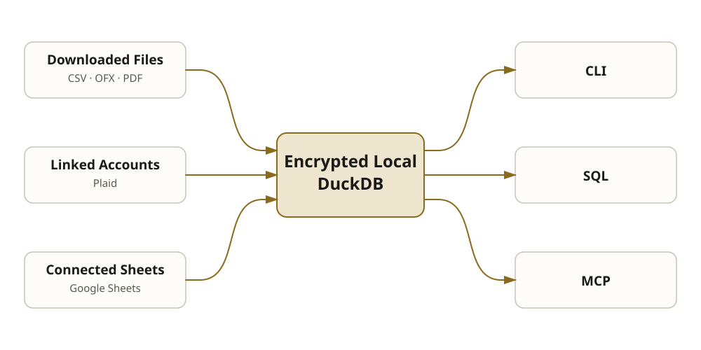

<!-- Last reviewed: 2026-10-14 -->
<!-- markdownlint-disable MD033 MD041 -->
<div align="center">
  <picture>
    <source media="(prefers-color-scheme: dark)" srcset="docs/assets/moneybin-logo-on-dark.svg">
    
  </picture>

  **A local data warehouse for personal finance.**

  Import financial data into an encrypted DuckDB database on your machine.
  Explore it with SQL, use built-in reports, or connect your AI assistant through MCP.

  [Try the demo](#try-it) · [Documentation](docs/README.md) · [Architecture](docs/architecture.md)

  [](https://github.com/bsaffel/moneybin/actions/workflows/ci.yml)
  [](LICENSE)
  [](https://www.python.org)
  [](https://duckdb.org)
</div>
<!-- markdownlint-enable MD033 MD041 -->

Bring bank exports, linked accounts, and spreadsheets together to track spending,
find recurring charges, and follow your net worth. The CLI and 50-tool MCP server
read the same tables; the SQL behind each report is available to inspect.

<!-- markdownlint-disable MD033 -->
<picture>
  <source media="(prefers-color-scheme: dark)" srcset="docs/assets/moneybin-workflow-on-dark.svg">
  
</picture>
<!-- markdownlint-enable MD033 -->

MoneyBin is pre-v1 and installs from source. I use it for my own finances.
macOS and Linux are supported; Windows is untested.

## Try it

Requires Python 3.12+, [uv](https://docs.astral.sh/uv/), Git, and GNU Make.

```bash
git clone https://github.com/bsaffel/moneybin.git
cd moneybin
make setup
uv run moneybin demo
```

The demo loads synthetic data into a separate profile. No bank connection or AI
account is needed. It makes `demo` the active profile.

Query the largest spending categories. This example uses synthetic USD data:

```console
$ uv run moneybin sql query "
    SELECT category, COUNT(*) AS txns, SUM(amount) AS total
    FROM core.fct_transactions
    WHERE amount < 0 AND category IS NOT NULL
    GROUP BY 1 ORDER BY total ASC LIMIT 5"
┏━━━━━━━━━━━━━━━━━━━━━┳━━━━━━┳━━━━━━━━━━━━┓
┃ category            ┃ txns ┃      total ┃
┡━━━━━━━━━━━━━━━━━━━━━╇━━━━━━╇━━━━━━━━━━━━┩
│ Housing & Utilities │  144 │ -62,676.66 │
│ Food & Drink        │  304 │ -14,353.58 │
│ Services            │   36 │  -5,112.00 │
│ Shopping            │   88 │  -4,889.37 │
│ Transportation      │  113 │  -3,609.95 │
└─────────────────────┴──────┴────────────┘
```

Follow the [getting-started guide](docs/guides/getting-started.md) to import a bank
export and run your first reports.

## Connect your AI assistant

From the checkout, connect Claude Desktop:

```bash
uv run moneybin mcp install --client claude-desktop
```

Restart the client, then ask: *"Which merchants account for most of my spending?"*
The [MCP setup guide](docs/guides/mcp-clients.md) covers other supported clients.

File imports, CLI, and SQL need no vendor account. Broker-backed sync and Google
Sheets authorization are opt-in network paths. MoneyBin sends no telemetry. If
you connect a cloud AI assistant, its provider receives the tool results.
See [what the AI provider sees](docs/guides/what-the-ai-sees.md) for details.

## Documentation

- [Getting started](docs/guides/getting-started.md) — import your own data
- [Reports](docs/guides/reports.md) — spending, cash flow, net worth, and saved queries
- [Features](docs/features.md) — what works today
- [Database and security](docs/guides/database-security.md) — encryption and backups
- [Where MoneyBin fits](docs/audience.md) — who it is for and alternatives

## Contributing

Bug reports and focused pull requests are welcome. See [CONTRIBUTING.md](CONTRIBUTING.md)
or open an [issue](https://github.com/bsaffel/moneybin/issues).
Licensed under [AGPL-3.0](LICENSE).
