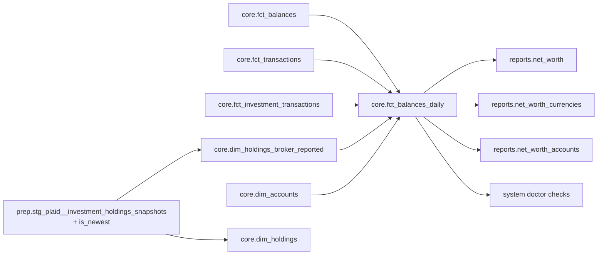

# Feature: Net-Worth Guard on the Daily Balance Spine

## Status
implemented

## Goal

Move the net-worth guard from a separate view into the table every net-worth
reader already sums. An account that holds value with no recorded balance gets
rows with a NULL `balance` in `core.fct_balances_daily`, and each row says
whether it counts toward net worth. Each reader then makes one aggregation
instead of reassembling the guard itself. The result covers all three rungs,
including the currency rung that has none today.

M2B.4, refining M2B.3 (Requirement 14 of
[`reports-net-worth-sql-surface.md`](reports-net-worth-sql-surface.md)). The
guard's promise is unchanged: an eligible account carrying evidence of value
and no balance observation never contributes a silent zero. This spec changes
where that promise lives and how a reader keeps it.

## Background

### What shipped

M2B.3 added `core.dim_unanchored_accounts`, a VIEW holding one row per account
with value evidence and no row on the balance spine. The net-worth readers use
it as follows:

- `reports.net_worth` joins it to each day's balance rows. When no balance rows
  exist, it synthesizes one row dated at a fallback date.
- `reports.net_worth_accounts` appends one synthesized row per candidate account
  at that same fallback date.
- The two report runners add a second synthesis for an explicit date range.
- Both `system doctor` checks read it, or read a `reports` view.

### What is wrong with that shape

1. **The currency rung has no guard.** `reports.net_worth_currencies` sums the
   balance spine and never reads the candidate view. An eligible unanchored
   account changes no row there, and the rung silently leaves it out (Out of
   Scope in the M2B.2 spec).
2. **Each read pays for the whole candidate set.** The view unions four evidence
   sources and anti-joins the spine on every read. The two report models read it
   two or three times each, and the doctor checks scan a `reports` view to find a
   single date.
3. **The rules are copied, not shared.** At the time of writing:
   - the date-scoped eligibility predicate (`include_in_net_worth`,
     `archived`, `archived_at`) appears 8 times across the 3 report models,
     once in `_shared.unanchored_candidates_ctes`, and once in the doctor's
     unanchored check. The stale-balance check uses a present-tense
     `NOT archived` instead, which is a second rule;
   - the fallback-date expression appears twice in SQL, plus a ranged variant
     (`synthesis_date`) in Python;
   - the newest-holdings-snapshot ranking appears 3 times (`dim_holdings.sql`,
     `dim_holdings_broker_reported.sql`, and
     `doctor_service._NEWEST_HOLDINGS_SNAPSHOT_CTE`).
4. **Ranged and unranged reads disagree.** The model synthesizes one row at a
   fallback date. The runner synthesizes a different row for a requested range.
   So an account's unanchored state depends on whether a range was given, and an
   account that only gains evidence partway through a range is counted
   unanchored across the whole range.

### The schema rule this applies

A new `core` relation has to clear a very high bar. Otherwise the concept
becomes a filterable attribute on an existing `core` table. A NULL balance on
the spine is that kind of attribute: it records "this account holds value and
its balance is unknown" at the grain where it applies, which is one account on
one day. No separate relation is needed to hold it, and reasons 1 to 4 above
all follow from having one.

### Unshipped state

M2B.3 merged in PR #650 and has not been released (`CHANGELOG.md` names no
`dim_unanchored_accounts`). The changelog fragments
`changelog.d/+net-worth-unanchored-guard.added.md` is therefore rewritten to
describe the final behavior; its `.changed.md` sibling, which records only the
`unanchored_account_count` column position, stays. No released contract
changes.

## What this supersedes in `reports-net-worth-sql-surface.md`

That spec stays `implemented`. Its decisions stand except for the parts below,
which this spec replaces:

| Section there | Replaced by |
|---|---|
| Requirement 14: "A profile with no balance-spine row at all still gets exactly one" and "The one row with no `balance_date` of its own" | Requirements 1 to 3 below. Every unanchored account carries its own dated rows, so nothing is synthesized. |
| Requirement 14: "Scoped to the account, not to the date" | Requirement 2. Unanchored state starts at the account's first evidence, not at the start of the range. |
| Out of Scope: the guard on `reports.net_worth_currencies` | Requirement 5. |
| Data Model: `core.dim_unanchored_accounts`, `reports.net_worth` fallback arm, `reports.net_worth_accounts` candidate arm | §Data Model below. |
| Doctor checks: what each one reads | Requirement 7. |
| Deviations 1 (shared candidate relation) and 7 (synthesis date) | Deleted together with the relation and the synthesis date. |
| Key Decision 6 (no rung materialized without moving the filter to read time) | Reconciled in Key Decision 3 below. The filter moves to `core.fct_balances_daily`, which is rebuilt in full, and the rungs stay views. |

The old spec gets a one-line pointer to this one under Status. Nothing else in
it is edited.

## Requirements

1. **The spine holds every account with value evidence.** `core.fct_balances_daily`
   gives an account rows whether or not it has a balance observation:
   - **Value evidence** is at least one row in `core.fct_transactions` or
     `core.fct_investment_transactions`, or `has_position = TRUE` in
     `core.dim_holdings_broker_reported`. Open lots need no separate arm:
     `core.fct_investment_lots` is built only from
     `core.fct_investment_transactions`, and each lot carries the ledger row's
     `account_id` (`investments/sqlmesh_loader.py:109`).
   - **A bootstrap trade is evidence.** A Plaid position with no in-window
     trades gets an opening-lot trade (`prep.stg_plaid__opening_lots`), dated
     one day before the transaction window starts. That row sits in
     `core.fct_investment_transactions`, so it counts as a trade and its
     account's NULL rows start on that date, not on the snapshot's `as_of`.
   - **An account with no observation** gets rows with `balance` NULL,
     `is_observed` FALSE, and NULL `observation_source` and
     `reconciliation_delta`.
   - **The currency of those rows** is `core.dim_accounts.currency_code`, which
     may itself be NULL (the unknown-currency segment).
   - **An account with at least one observation** keeps today's rows unchanged:
     carry-forward, source precedence, and reconciliation all work as before.
2. **Unanchored rows start at first evidence.** An account with no observation
   starts on the earliest of its first `transaction_date`, its first
   `trade_date`, and the `as_of` of a broker-reported nonzero position. An
   account with an observation still starts at its first observation. The
   months between an account's first transaction and its first statement stay
   uncovered; that gap is a follow-up (§Out of Scope).
3. **The spine ends at the newest evidence date.** Every account runs to the
   newest date among all observations, transaction dates, trade dates and
   broker `as_of` dates in the profile.
   - **Why:** a profile holding only CSV transactions has no observations, so an
     end date based on observations alone produces no rows, and the guard goes
     silent in exactly the case it exists for.
   - **No cap at today:** the end is never limited to `CURRENT_DATE`, which
     keeps the FULL model deterministic. A future-dated transaction extends the
     spine: one transaction dated years ahead gives every account a row on every
     day up to it, and moves the latest date of every rung to that date.
   - **Behavior change:** an anchored account whose transactions run past the
     newest statement is carried forward to the newest transaction, with those
     transactions applied. The existing carry-forward walk already does this
     between observations.
4. **`in_net_worth` is computed once, per row.** A new
   `in_net_worth BOOLEAN` column on `core.fct_balances_daily` says whether this
   account counts toward net worth on this date. The model reads
   `core.dim_accounts` once and derives each account's last counting date:
   - **never**, when `include_in_net_worth` is FALSE, or the account is archived
     with `archived_at` NULL (undated legacy archives, unchanged from today);
   - **`archived_at`**, when the account is archived with a known date;
   - **no end**, when the account is not archived.

   The row's value is `balance_date <= last counting date`. An `account_id` with
   no `core.dim_accounts` row is FALSE, which matches today's INNER JOIN.
   Every reader filters on this column; no reader restates the predicate.
5. **Every rung withholds a total built on an unknown balance.**
   - **`reports.net_worth`:** filters `in_net_worth`.
     `unanchored_account_count` is the number of distinct accounts with a NULL
     `balance` on the date. The three measures are NULL when that count is
     above 0, as they already are when `unpriced_currency_count` is above 0.
     `account_count` and `carried_forward_count` count only rows with a known
     balance.
   - **`reports.net_worth_currencies`:** gains `unanchored_account_count` for
     each currency and date. When it is above 0, every measure for that currency
     and date is NULL, both in the currency itself and in the home currency.
   - **`reports.net_worth_accounts`:** filters `in_net_worth`. An unanchored
     account appears on every date it has rows, with NULL balance columns and
     NULL `days_since_observed`. The candidate arm is deleted.
6. **Ranged and unranged reads return the same rows for the same date.** Both
   runners filter the view by date and nothing else. `_source_cte`'s
   synthesized arm, `net_worth_accounts`'s candidate arm and
   `_shared.unanchored_candidates_ctes` are deleted.
   - **Before an account's first evidence:** a range gets no unanchored rows for
     it. The account had no evidence then.
   - **After the spine end:** a range gets no rows at all, so no total is
     reported for it.
   - **Every account archived:** an unranged read returns the newest date on
     which any account still counts, not an empty result, because the rungs
     filter `in_net_worth` before taking the latest date. The total on that
     row is NULL when an account counted on it has no balance observation.
7. **The doctor checks read the spine, not a `reports` view.**
   - **`net_worth_unanchored_accounts` (`fail`):** returns the accounts with a
     NULL `balance` and `in_net_worth` TRUE on the latest date on which any
     account counts toward net worth (`MAX(balance_date)` over the rows with
     `in_net_worth` TRUE). That is the date an unranged `reports.net_worth`
     read lands on, so the check reads the same total the user sees. It equals
     the spine's last date unless every account that counts was archived
     before it; then it is the newest archive date, and an account with no
     balance observation on it still fails the check.
   - **`net_worth_stale_balance` (`warn`):** looks at the accounts that have
     `in_net_worth` TRUE and a known balance on that same date. For each
     one it measures age as `CURRENT_DATE` minus its latest observed
     `balance_date`, against the same `doctor.balance_staleness_threshold_days`.
     Before this change the check excluded accounts that are archived now. This
     version excludes accounts archived before that date. The two differ only
     for an account archived on or after that date, which still counts in the
     latest total and is now checked as well.
   - **Unchanged:** both checks keep their gauges
     (`NET_WORTH_UNANCHORED_ACCOUNTS`, `NET_WORTH_STALE_BALANCE_ACCOUNTS`), their
     masked `affected_ids`, and `skipped` when the table is absent.
8. **The newest snapshot is ranked in one place.** A new `is_newest BOOLEAN`
   column on `prep.stg_plaid__investment_holdings_snapshots` is TRUE for the
   newest receipt per `source_origin`. Ordering is `extracted_at DESC`, then
   `ingestion_sequence DESC`, the same as today's three copies.
   `core.dim_holdings`, `core.dim_holdings_broker_reported` and the doctor
   filter on it. `investments/source_overlap.py` ranks transaction receipts,
   not snapshots, and stays as is.
9. **The other spine readers handle a NULL balance correctly.**
   - **`BalanceService`** (`current_balances`, `history`): passes the NULL
     through; `BalanceObservationRow.balance` is `Decimal | None`. The
     `accounts balance` CLI (`show`, `history`) renders "no balance recorded",
     and the MCP `accounts_balances` description says `balance` is null for an
     account that holds value but has no recorded balance. `reconcile` filters
     on `reconciliation_delta IS NOT NULL`, so it never sees these rows.
   - **The export bundle `balances_daily`:** carries the NULL rows and the new
     column, with a refreshed bundle snapshot.
   - **Checked, no change needed:**
     - `reports.balance_drift` joins on assertion dates, which an unanchored
       account never has;
     - `core.fct_exchange_rates_daily` takes only currency and date bounds from
       the spine;
     - `rate_backfill` asks for currency/date pairs that transactions already
       cover.

     Each still gets one test with a NULL row present.
10. **The NULL is documented where readers look.**
    - **The `balance` column description:** says it is NULL when the account
      holds value but has no balance observation, and that a sum must count
      those rows before trusting the total.
    - **`schema_catalog.py`:** gains a `core.fct_balances_daily` example of a
      guarded net-worth sum, so `sql_query` users see the pattern instead of
      inventing a bare `SUM(balance)`.
11. **Freshness is unchanged.** `core.dim_accounts` is already a FULL model, so
    an `accounts set` change already needs `moneybin refresh --step transform`
    to reach the reports. `in_net_worth` is computed in the same run. A balance
    recorded with `accounts balance assert` still anchors the account only after
    the next refresh, which matches Requirement 14 of the M2B.2 spec.

12. **Observability.** No metric is added. The two existing gauges keep their
    names and meaning (Requirement 7), and the report-execution metrics every
    catalog report emits cover the three rungs unchanged.

## Data Model

**Cycle check.** None of the five inputs reads `core.fct_balances_daily`,
directly or through another model:

- `core.dim_accounts` reads `prep` and `app` only;
- `core.dim_holdings_broker_reported` reads `prep` only;
- the fact tables reach `core.dim_accounts` but nothing downstream of the
  spine.

### `core.fct_balances_daily` (Python model, kind FULL)

`depends_on` adds three models: `core.fct_investment_transactions`,
`core.dim_holdings_broker_reported` and `core.dim_accounts`.

| Column | Type | Change |
|---|---|---|
| `account_id` | VARCHAR | unchanged |
| `balance_date` | DATE | unchanged |
| `balance` | DECIMAL(18, 2) | now NULL on unanchored rows |
| `is_observed` | BOOLEAN | FALSE on unanchored rows |
| `in_net_worth` | BOOLEAN | **new**: whether this account counts toward net worth on this date |
| `observation_source` | VARCHAR | NULL on unanchored rows |
| `reconciliation_delta` | DECIMAL(18, 2) | NULL on unanchored rows |
| `currency_code` | VARCHAR | from `core.dim_accounts` on unanchored rows |

The new column sits next to `is_observed`. The existing columns keep their
order: reordering a `core` column to Rule A of
`.claude/rules/column-ordering.md` is a separate public-contract change, and
this one does not take it on.

**How the model builds the rows.** These are extensions to the existing walk,
not a second walk:

1. Fetch the observations, per-account transaction sums by date (as today),
   per-account `MIN`/`MAX` of `trade_date`, the broker `as_of` dates where
   `has_position`, and `core.dim_accounts` eligibility.
2. Compute the spine end as the newest date across all four sources.
3. For each account with observations, run today's walk, ending at the new
   spine end.
4. For each account with evidence and no observations, emit NULL-balance rows
   from its first evidence date to the spine end.
5. Stamp `in_net_worth` on every row from that account's last counting date
   (Requirement 4). The "never" and "no end" values are the inline
   `date.min` and `date.max`: SQLMesh serialises every module global a Python
   model reaches and cannot serialise a module-level date.
6. When there are no observations and no evidence at all, yield nothing, as
   today.

The walk is split into pure functions (`_build_spine_rows`, `_evidence_sql`,
`_counts_through`), so its unit tests run without SQLMesh.

### `prep.stg_plaid__investment_holdings_snapshots`

Adds `is_newest BOOLEAN`, computed as
`ROW_NUMBER() OVER (PARTITION BY source_origin ORDER BY extracted_at DESC,
ingestion_sequence DESC) = 1`. The model stays a `prep` view with no column
comments, per `.claude/rules/database.md`.

### Report models

Each of the three models replaces its eligibility block with
`WHERE d.in_net_worth` and stops reading `core.dim_unanchored_accounts`.

- **`reports.net_worth`:**
  - computes `unanchored_account_count` per day from the rows, as
    `COUNT(DISTINCT account_id) FILTER (WHERE balance IS NULL)`;
  - restricts `account_count` and `carried_forward_count` to rows where
    `balance IS NOT NULL`;
  - deletes the `candidates`, `unanchored_per_day`, `spine_max`,
    `unanchored_at_spine_max` and fallback `UNION ALL` arms.
- **`reports.net_worth_currencies`:** adds `unanchored_account_count INT`
  between `carried_forward_count` and `total_assets` (Rule B: counts before
  measures). Its measures are wrapped in the same NULL-when-unknown rule.
- **`reports.net_worth_accounts`:** loses its `UNION ALL` arm.

Each model's header comment drops the fallback-date text. Each declared class
map in `reports/definitions/` gains or keeps `unanchored_account_count` as
`DataClass.AGGREGATE`. The provenance tuples drop `core.dim_unanchored_accounts`.

### Deleted

- `src/moneybin/sqlmesh/models/core/dim_unanchored_accounts.sql`, together with:
  - its `DIM_UNANCHORED_ACCOUNTS` constant in `tables.py`;
  - its `CLASSIFICATION` entry in `privacy/taxonomy.py`;
  - its `schema_catalog.py` entry;
  - every test and fixture reference.
- `_shared.unanchored_candidates_ctes` and its callers' synthesized arms.
- `doctor_service._NEWEST_HOLDINGS_SNAPSHOT_CTE`.

## Implementation Plan

### Files to Create

- `changelog.d/+net-worth-guard-currency-rung.changed.md`: the currency rung's
  new column and NULL rule.
- `changelog.d/+net-worth-guard-balance-spine.changed.md`:
  `core.fct_balances_daily.in_net_worth`, NULL-balance rows, the new spine end,
  and the `balances_daily` export, `accounts balance` and `accounts_balances`
  surfaces that carry them.

### Files to Modify

**Models**
- `src/moneybin/sqlmesh/models/core/fct_balances_daily.py`: Requirements 1 to 4,
  plus the module docstring and column descriptions.
- `src/moneybin/sqlmesh/models/prep/stg_plaid__investment_holdings_snapshots.sql`:
  adds `is_newest`.
- `src/moneybin/sqlmesh/models/core/dim_holdings.sql` and
  `src/moneybin/sqlmesh/models/core/dim_holdings_broker_reported.sql`: filter
  `is_newest` instead of ranking.
- `src/moneybin/sqlmesh/models/reports/net_worth.sql`,
  `src/moneybin/sqlmesh/models/reports/net_worth_currencies.sql` and
  `src/moneybin/sqlmesh/models/reports/net_worth_accounts.sql`: per §Report
  models.

**Report definitions**
- `src/moneybin/reports/definitions/net_worth.py`:
  - `_source_cte` reduces to the filtered read, with no pass-through CTE;
  - the `_default_columns` docstring drops the deleted mechanism;
  - the `exclusions` and `provenance` text is updated.
- `src/moneybin/reports/definitions/net_worth_accounts.py`:
  - `_COLUMNS` becomes a tuple joined at use, matching `net_worth._VIEW_COLUMNS`;
  - the candidate arm is deleted, and the docstring and `exclusions` are
    updated.
- `src/moneybin/reports/definitions/net_worth_currencies.py`: the new column,
  its class, and the `exclusions` text.
- `src/moneybin/reports/definitions/_shared.py`: deletes
  `unanchored_candidates_ctes`; `DateRange` loses `from_bound`, `to_bound` and
  `is_ranged`, which only the deleted synthesis read.

**Doctor**
- `src/moneybin/services/doctor_service.py`: the two net-worth checks
  (Requirement 7) and `is_newest` in place of `_NEWEST_HOLDINGS_SNAPSHOT_CTE`.

**Balance surfaces**
- `src/moneybin/privacy/payloads/balances.py` (`balance` becomes nullable) and
  `src/moneybin/cli/commands/accounts/balance.py`: Requirement 9.
  `src/moneybin/services/balance_service.py` needs no code change; it passes
  the NULL through.
- `src/moneybin/mcp/tools/accounts.py`: the `accounts_balances` description
  gains the null-balance sentence (1,098 to 1,177 serialized bytes).

**Bookkeeping**
- `src/moneybin/database.py`: the `core.fct_balances_daily` column set.
- `src/moneybin/privacy/taxonomy.py`: `in_net_worth` as `DataClass.TXN_TYPE`,
  matching `is_observed`.
- `src/moneybin/services/schema_catalog.py`: Requirement 10.
- `src/moneybin/tables.py`: removes `DIM_UNANCHORED_ACCOUNTS`.

**Changelog and docs**
- `changelog.d/+net-worth-unanchored-guard.added.md`: rewritten to the final
  behavior (§Unshipped state); `.changed.md` is unchanged.
- `docs/specs/reports-net-worth-sql-surface.md`: a one-line Status pointer.
- `docs/specs/INDEX.md`: a new row for this spec.
- `docs/roadmap.md`: the M2B.4 entry.
- `docs/specs/moneybin-doctor.md`: the two net-worth check rows and their
  pointer to this spec.
- `docs/specs/document-account-binding.md` and
  `tests/moneybin/test_architecture/test_table_reference_literals.py`: prose
  that named the deleted `_NEWEST_HOLDINGS_SNAPSHOT_CTE`.
- `docs/reference/data-model.md`: the `core.fct_balances_daily` section, and the
  `core.dim_unanchored_accounts` section removed.
- `docs/reference/cli/reports.md` and `docs/reference/mcp-tools.md`: generated
  from the report and tool definitions.
- `docs/decisions/016-bounded-mcp-tool-registry.md` and
  `docs/specs/mcp-tool-surface-scaling.md`: the quoted `standard.json`
  measurements (64,363 bytes, a -26,476-byte delta against the baseline).

**Tests**
- §Testing Strategy.
- `tests/fixtures/mcp_surface/standard.json` (regenerated) and the
  `accounts_balances` byte pin in
  `tests/moneybin/test_mcp/test_tool_surface_budget.py`.
- `tests/moneybin/test_mcp/test_capability_parity.py` and
  `tests/e2e/test_e2e_reports.py`: stubs for the spine's `in_net_worth` and the
  currency rung's `unanchored_account_count`.

### Files to Delete

- `src/moneybin/sqlmesh/models/core/dim_unanchored_accounts.sql`

### Key Decisions

1. **NULL rows on the spine, not a new relation.**
   - **Why not a new relation:** the core-schema rule above. Requirement 14's
     state belongs to one account on one day, and the spine already has that
     grain.
   - **What it costs:** auditing every reader of `core.fct_balances_daily` for
     NULL safety. The audit is in Requirement 9: two readers need changes and
     three need none.
2. **The flag lives on the spine, not on `core.dim_accounts`.** A
   `dim_accounts` column cannot answer "on this date": archival is
   date-scoped, so the answer depends on `balance_date`. Leaving the archive
   date on `dim_accounts` would still make every reader rewrite the date
   comparison.
3. **Key Decision 6 of the M2B.2 spec is respected, not overridden.** That
   decision guards against freezing a reversible filter into stored rows that
   nothing recomputes. `core.fct_balances_daily` is kind FULL, so every refresh
   recomputes `in_net_worth` from current settings. `core.dim_accounts`, the
   source of those settings, is itself FULL and on the same refresh, so
   nothing goes stale that was not already stale. The rungs stay `kind VIEW`.
   This holds only while the spine is FULL. If the spine ever becomes
   incremental, `in_net_worth` has to move back to read time first. The
   column's description says so.
4. **The spine ends at the newest evidence, uncapped.** The alternatives were
   two end rules (observations when present, evidence otherwise) or a cap at
   `CURRENT_DATE`. Two rules give two behaviors for one column. A cap makes a
   FULL table depend on the day it was built. Chosen in design review on
   2026-10-07.
5. **The undated-archive rule is kept, not reopened.** V063 left `archived_at`
   NULL where no audit evidence existed. Such accounts stay excluded on every
   date, as today. Letting the user supply the date is a follow-up.

## CLI Interface

No commands are added or renamed. Two outputs change:

- **`moneybin accounts balance`:** shows `no balance recorded` for an account
  whose latest spine row has a NULL balance, instead of leaving the account
  out.
- **`moneybin reports net-worth-currencies --wide`:** gains the
  `unanchored_account_count` column.

The doctor check names and messages are unchanged.

## MCP Interface

No tools are added or renamed.

- **`accounts_balances`:** each observation's `balance` becomes nullable, and
  the description says so.
- **`reports(report_id="core:net_worth_currencies")`:** gains
  `unanchored_account_count`.
- **The MCP surface snapshot** (`tests/fixtures/mcp_surface/standard.json`):
  regenerated, because the `accounts_balances` description grew. The frozen
  `baseline-2026-07-17.json` is unchanged; it is the historical figure the
  budget tests compare against. The snapshot's comparison test is
  integration-tier, so `make test` does not catch it.

## Testing Strategy

Each test below is written before the code that makes it pass.

### Tier 1: Unit

**`tests/moneybin/test_fct_balances_daily.py`.** These tests take over the
evidence cases from the `core.dim_unanchored_accounts` tests in
`tests/moneybin/test_unanchored_guard_models.py`, which are deleted, so every
kind of evidence keeps a test:

- **Unanchored accounts:**
  - an account with only cash transactions gets NULL rows from its first
    transaction to the spine end;
  - the same holds for an account with only investment transactions, including
    dividend-only;
  - an account whose only evidence is a broker-reported position starts at that
    position's `as_of`;
  - a liquidated investment account (broker `has_position = FALSE`, ledger
    present) still gets NULL rows;
  - an account with no evidence gets no rows (the residual gap Requirement 14
    names).
- **Anchored accounts:** an account with one observation keeps today's start
  date and gets no NULL rows.
- **Spine end:**
  - a transaction dated after the newest observation moves the end, and the
    anchored account's carry includes that transaction;
  - a profile with only CSV transactions still produces rows.
- **`in_net_worth`:**
  - an active account is TRUE on every date;
  - an account excluded from net worth is FALSE on every date;
  - an account archived on a known date is TRUE through that date and FALSE
    after it;
  - an account archived with no date is FALSE on every date;
  - an orphan `account_id` is FALSE.

**`tests/moneybin/test_unanchored_guard_models.py`.** The broker-reported tests
stay. A new test covers `is_newest` when two receipts share `extracted_at` and
differ only in `ingestion_sequence`.

**Report models** (`tests/moneybin/test_reports/test_net_worth_models.py`):

- **Each rung:** a date with one NULL-balance account withholds its measures,
  and the count is 1.
- **Currency rung:** the withholding is per currency, so a priced, fully
  anchored second currency on the same date keeps its measures.
- **`account_count` and `carried_forward_count`:** neither counts a NULL row.

**Report runners** (`tests/moneybin/test_reports/test_net_worth_runners.py`):

- a ranged read and an unranged read return identical rows for the latest date;
- a range before an account's first evidence returns no unanchored row for it.

**Doctor** (`tests/moneybin/test_services/test_doctor_service.py`):

- both checks against the spine, including the archive-date boundary on the
  latest date on which any account counts, and a profile where that date is
  earlier than the spine's last date;
- a source scan asserts neither check reads a `reports.*` relation.

**Balance surfaces** (`test_balance_service.py`, `test_accounts_balance.py`,
`test_mcp/test_accounts.py`): a NULL balance comes through as `None`, the CLI
renders "no balance recorded", and the MCP JSON carries `null`.

**Safe readers** (`test_fct_exchange_rates_daily.py`, `test_rate_backfill.py`,
and the `balance_drift` model test): one test each with a NULL row present.

**Bookkeeping:**

- `tests/moneybin/db_helpers.py` and its parity test;
- `test_tables.py`;
- the taxonomy coverage tests;
- `tests/moneybin/test_exports/test_bundle_snapshot.py` (snapshot refreshed);
- `tests/privacy/fixtures/sql_lineage_corpus.yaml` (the
  `dim_unanchored_accounts` entries removed);
- `test_report_class_derivation.py`.

### Tier 2: Synthetic scenarios

- **`tests/scenarios/test_net_worth_unanchored.py`:** keeps its three profiles
  (mixed, wholly unanchored, liquidated investments). The assertions move from
  the synthesized row to the per-date rows, and a currency-rung assertion is
  added to each.
- **`tests/scenarios/test_net_worth_rungs.py`:** re-derives its expected dates
  by hand from the fixture where the new spine end moves them.
- **Every changed scenario expectation:** derived from the input fixture, per
  `.claude/rules/testing.md`. It is never pasted from output.

### Tier 3: Integration

The MCP surface baseline regeneration, plus the existing
`tests/scenarios/test_account_settings_archive.py`, which runs unchanged
against the new spine.

### Gate

This change touches `database.py`, `tables.py`, `privacy/` and
`tests/moneybin/db_helpers.py`, and it changes a data shape. So the gate is:

1. `make check` and `make format-sql`;
2. `make test`, `make test-integration` and `make test-scenarios`.

## Synthetic Data Requirements

None new. The three scenario profiles in `test_net_worth_unanchored.py` and the
fixtures in `test_net_worth_rungs.py` already exercise every evidence kind. The
`family` persona's CSV accounts check the spine-end change end to end.

## Dependencies

No new packages. Prerequisites: M2B.3 (PR #650) and V063 (`archived_at`), both
merged.

## Out of Scope

- **Accounts before their first statement.** An account whose transactions
  start before its first observation has no rows for those months, so net worth
  leaves it out there without a warning. The fix is either back-deriving
  balances or emitting NULL rows from first evidence for anchored accounts too.
  It is a follow-up, because either way it changes anchored accounts' history.
- **Undated legacy archives.** A `system doctor` check could list archived
  accounts with `archived_at` NULL so the user can supply a date, as V063
  envisioned. Today they are excluded on every date. That is a follow-up.
  `account_archive_intent_ambiguous` covers a different set of accounts (the
  retired cascade's `include_in_net_worth` flips).
- **Demo stale-balance warning.** Whether `moneybin demo` and the
  getting-started profile should raise `net_worth_stale_balance` is the
  remaining MB-268 item, and it is decided separately.
- **Audit of the other `core` relations.** This is the final task of this work's
  implementation plan. It reviews every other `core` table and view against the
  core-schema rule and records, for each, whether it could become a filterable
  attribute on an existing table, any reason it should stay separate, and a
  recommendation. The output is a list of findings to file as follow-ups; this
  change makes no edits from it.
- **Column order in `core.fct_balances_daily`.** It predates Rule A, and
  reordering it is its own public-contract change.
