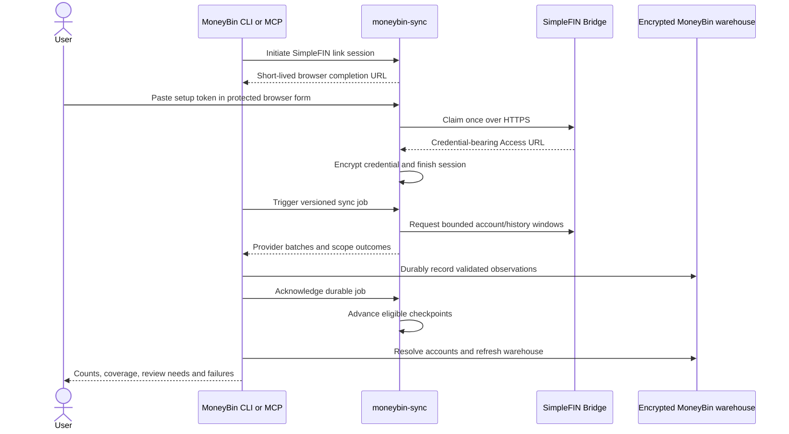

# Sync: SimpleFIN provider

## Status
<!-- draft | ready | in-progress | implemented -->
in-progress

**Address:** M1G.5. **Release:** Early Access.

The mediated trust boundary and contributor-facing contract were approved on
2026-10-01. The implementation plan was approved for subagent-driven execution.
Implementation and synthetic joint acceptance are locally verified. Final
delivery review, deployment and non-author live acceptance remain open.

## Outcome and scope

A user links SimpleFIN through moneybin-sync, pulls supported cash and credit
accounts, and sees reconciled balances and posted transactions in MoneyBin.
Repeated pulls and overlapping file imports must preserve one canonical event
per real transaction. Unsupported or incomplete data must remain visible as
such instead of producing apparently complete financial totals.

Includes secure one-time setup, connection health, bounded history retrieval,
currency preservation, account identity, CLI/MCP parity, doctor checks, and a
non-author live acceptance run. Investment activity, holdings, loan enrichment,
pending-transaction reporting, arbitrary SimpleFIN server hosting, a generic
connector SDK, and warehouse replication are outside this increment.

Related contracts: [sync overview](sync-overview.md),
[Plaid](sync-plaid.md), [account identity](account-identity-resolution.md),
[privacy](privacy-data-protection.md), and
[surface admission](mcp-tool-surface-scaling.md).

## Decision: retain the mediated sync boundary

The MoneyBin client communicates only with moneybin-sync. The broker claims
and encrypts the SimpleFIN Access URL, performs upstream requests, and returns
provider-shaped data. MoneyBin owns Raw, staging, reconciliation, and reports.
SimpleFIN therefore uses the existing `sync` journey, not a new direct-access
command family.

| Concern | Selected: mediated access | Considered: direct client access |
|---|---|---|
| Credentials and payloads | SimpleFIN and the configured broker see the credential/data; the client receives financial data but never the Access URL | SimpleFIN and each MoneyBin runtime hold the integration boundary |
| Local use and failures | Existing reports remain local; new pulls depend on both broker and SimpleFIN | Removes the broker dependency from new pulls |
| Secret lifecycle | Broker encryption, replacement, disconnect, and recovery own the provider credential | Each profile needs provider-secret lifecycle and cleanup |
| Deployment | One integration implementation works behind self-hosted and hosted broker authentication | Simplifies local setup but introduces another integration path |
| Authentication and devices | Reuses broker authentication and profile isolation; does not imply warehouse replication | Each installation needs its own authorization and request coordination |
| Operations | Broker owns provider requests, quotas, and connection diagnosis | Each client owns these operations |
| Contract cost | Correct the existing Plaid-shaped adapter and payload seams | Add a second custody/connection architecture and revise the broker-only rule |

The broker exists to mediate aggregator access. Exercising that boundary with
a second aggregator is worth the additional deployment dependency. Direct
access would serve a separately chosen server-free product requirement.
For a same-machine self-hosted broker, process separation adds little privacy
exposure; a hosted broker adds its operator to the trust boundary.

Do not describe this as local-only or zero-knowledge. TLS and encryption at
rest do not prevent the broker from seeing upstream plaintext. Future
broker-to-client payload encryption may reduce storage exposure, but cannot
remove visibility at retrieval. This child supersedes any umbrella wording
that implies otherwise for this flow.

## Ownership and lifecycle

A **broker connection** is one credential grant, identified by an opaque broker
UUID. A SimpleFIN grant can contain multiple underlying institution connections
and accounts. Keep these identities separate: an institution name is a label,
not a credential key or unique selector.

The broker retains tenant ownership, encrypted credential, selected protocol,
credential generation, discovered scopes, health, request budget, and acknowledged
checkpoints. MoneyBin retains imported observations, provenance, accepted account
links/settings, and local ingestion/refresh outcomes. A local receipt is not a
second authority for live connection health.

Extend the broker's connection model to support both aggregators while retaining
existing Plaid UUIDs, credentials, cursors, and investment watermarks. All
queries and mutations are tenant-scoped. Provider-native identifiers must not
be globally unique database keys. A SimpleFIN-only deployment must not require
Plaid credentials or instantiate Plaid's adapter.

Keep a small shared adapter boundary for connection data retrieval and typed
checkpoint results. Hosted Link, webhook verification, and Plaid investment
operations remain Plaid capabilities; SimpleFIN must not implement fake versions
of them. Reuse existing HTTP, validation, encryption, result-store, and job
machinery. A new protocol SDK or plugin registry is unnecessary.

## Supported upstream contract

Support v1.0.7 and the v2.0.0 draft documented on 2026-09-27 with separate
validated models and frozen synthetic fixtures. Discover advertised versions
through `/info`; prefer the supported v2 shape when advertised, otherwise v1.
Request the selected major explicitly and persist it. Never silently change
major versions on an existing connection or fall back after malformed data.
Unknown majors fail with an upgrade action. Optional added fields are retained;
incompatible required-field changes fail validation.

v1 groups accounts by `org`; v2 supplies `connections`, account `conn_id`, and
structured `errlist`. Transactions are account-scoped; pending rows are possible
in both versions. Positive transaction amounts mean inflows. Balances carry
provider timestamps and optional available amounts. Currency can be ISO or a
custom URL. These differences must survive the broker boundary.

Initial support targets SimpleFIN Bridge. Broker configuration declares approved
HTTPS claim/data origins; it is not supplied through client requests. Validate
TLS certificates, host, port, path and resolved public destination; disable
redirects and environment-derived proxies for credential-bearing requests.
Reject private/link-local/loopback targets and DNS rebinding. Apply the same
checks to the returned Access URL. Never fetch custom-currency or institution
URLs found in financial payloads.

## Secure link and recovery

Reuse `POST /sync/link/initiate` with `provider="simplefin"`, the existing
short-lived link-session lifecycle, and status polling. The returned browser
URL completes the entire flow; the CLI/MCP caller never submits a provider
secret as an argument. Preserve the existing `widget_flow` discriminator for
this browser-completed workflow, and describe it as a browser flow in client
copy. The abandoned client-side `token_paste` behavior is not activated.

The broker form accepts the setup token in a POST body. The page uses an
expiring, single-session capability, CSRF protection, no third-party resources,
no caching, and no-referrer policy. Scrub capabilities from access logs. The
form explains which broker receives the token and links to Bridge's user page.
MCP supplies the completion action and polls `sync_status`; no token, Access
URL, or browser form content enters model context. No new MCP tool is needed.

Before claiming, validate the token's encoded URL, reserve the session attempt,
and verify credential persistence is available. Do not retry the one-time POST
automatically. A completed duplicate submission returns the original result;
an in-flight duplicate does not issue another claim. Store the returned URL
with the broker's existing authenticated encryption before marking linked.
Request bodies, upstream URLs containing credentials, validation inputs, and
HTTP exception strings must be excluded from logs and response diagnostics.

An interrupted claim can consume a token before its returned credential becomes
durable. Mark that session `claim_outcome_unknown`; instruct the user to disable
the old token and generate a new one. A rejected or already-used token receives
compromised-token guidance, not an automatic retry. A credential saved before
a lost client response is recovered by polling the same session.

Replacement names an existing broker connection explicitly. A failed replacement
preserves the old credential. Successful replacement increments its generation
and invalidates unacknowledged old-generation jobs. Preserve acknowledged
checkpoints only for verified unchanged native scopes under the same protocol.
New or ambiguous scopes restart the initial supported-window replay; a protocol
change always resets those checkpoints. Do not reuse old native
account bindings merely because names match. Changed upstream identity enters
the existing account-link review; protocol changes require explicit relinking.

Broker backup/recovery includes its encrypted credential store and encryption
key through the broker's existing operational procedures. A MoneyBin database
backup contains no provider credential. Lost broker credentials require relink;
rotating the broker encryption key must not change connection/source identity.

## Client/broker API contract

Broker envelope version and SimpleFIN protocol version are independent.

| Existing surface | Proposed extension |
|---|---|
| `POST /sync/link/initiate` | Forward provider selection; optional exact `connection_id` for replacement and opaque `consumer_id`; return the existing browser-session response |
| `GET /sync/link/status` | Return the completed broker connection UUID and provider; expose safe terminal claim outcomes |
| `POST /sync/trigger` | Add `contract_version=2`, `consumer_id`, optional `connection_id` or `provider`, `force=false`, and optional ISO `history_start`; reject conflicting selectors |
| `GET /sync/status` and `/sync/data` | Return the contract version selected at trigger, provider batches, and explicit per-scope outcomes |
| `POST /sync/ack` | Bind job-level durable acknowledgement to `consumer_id`; apply typed candidate checkpoints only to eligible scopes |
| `GET /institutions` | Include broker connection UUID and underlying scope identity; show grouped health without implying each institution has a separate credential |
| `DELETE /connections/{connection_id}` | Disconnect the whole credential grant; report local disconnection separately from upstream revocation |

Version 2 returns `job_id`, `contract_version`, terminal `status`, and `sources`.
Each source contains `provider`, `connection_id`, `credential_generation`,
`protocol_version` where applicable, and `batches` plus `outcomes`.
Each batch carries an immutable `batch_id`, fetch time, required nullable `window`,
and a provider-specific `payload`. SimpleFIN payloads retain the Account Set;
Plaid payloads retain today's wire values and semantics. No sign conversion,
account classification, categorization, or cross-source matching runs in the
broker. Credentials and HTTP transport metadata never enter payloads.

The source validates `window` on every batch and outcome: SimpleFIN requires a
requested UTC interval; Plaid requires explicit null because cursor cash data,
date-based investment transactions, and snapshots share its native payload.
Null means no single requested interval and supplies no history-coverage evidence.
Plaid investment metadata and its independent `investments_synced_through` cursor
remain unchanged. Validate the complete source/envelope before SimpleFIN ingestion;
a standalone shared batch does not establish date validity.

Each outcome identifies its connection/account scope, required nullable window,
`complete|partial|failed|deferred`, safe error code, and optional retry time.
Its native scope is tagged: a v1 organization record (including optional `id`),
a v2 `conn_id`, or a Plaid item ID, separate from the native account ID and the
broker connection UUID. Account-scoped SimpleFIN outcomes require that native
scope; complete outcomes also require native scope when no accounts exist.
Unscoped errors carry neither native scope nor account ID. The scope tag
must agree with the source provider and protocol. This prevents repeated native
account IDs in different institutions from sharing an outcome or checkpoint.
`complete` means the requested retrieval succeeded without a known scope error;
it does not certify that the institution supplies all historical activity.
A complete outcome must carry neither an error code nor a retry time.
Omitted accounts and unscoped errors prevent an all-accounts completeness claim.
Complete accountless Plaid outcomes must match an item delivered in native batch
metadata. Unmatched claims retain their original broker evidence but gain a local
partial outcome; they cannot establish retrieval completeness.

Rename the client's Plaid-shaped `SyncAccount`, `SyncTransaction`, `SyncBalance`,
and `SyncDataResponse` internals to explicit Plaid names. Shared job, connection,
and outcome models remain shared. Dispatch typed batches by provider; never
send SimpleFIN through `PlaidExtractor` or sign-flip its transactions.

Deploy the additive broker contract first. Version-1 requests remain Plaid-only;
they cannot silently return mixed arrays or ignore a selected SimpleFIN grant.
Old clients receive an upgrade-required refusal when their request would cover
unsupported grants. Upgraded clients request version 2 explicitly, validate the
returned version, and fail clearly against a broker that cannot supply it.
The existing Plaid path remains covered during the coordinated transition;
retire its old wire version only through a separately accepted contract change.

## Bounded retrieval and durable acknowledgement

The broker owns all upstream request scheduling, including manual pulls.
Bridge requests are limited to 90-day ranges, with a five-day overlap on
successive windows. Use complete UTC days: every boundary is UTC midnight, and
no exclusive end is later than the start of the current day. Initial and
forced retrieval request the latest 90 complete days. An explicit
`history_start` requests older recovery,
including UTC midnight on that date; reject future dates and conflicting
`force`/`history_start` inputs. Ordinary incremental work advances from the
acknowledged forward watermark minus the overlap. Recovery processes recent
data first, then older windows in descending date order until the requested
start or job budget is reached. Persist a separate acknowledged backward
coverage boundary and requested target; a resumed job continues the oldest
uncompleted window. Forward freshness must not erase unfinished backfill.
History availability varies; an empty oldest window is not proof of full history.

After a long gap, the latest successful window may be disconnected from the
older acknowledged interval. Store its two UTC-day boundaries as a second
contiguous, account-scoped recovery interval. Later jobs refresh that interval
and descend from its oldest boundary, with five-day overlap, until a successful
window joins the older interval. Merge the intervals only on receipt-backed ack;
failed, absent or unacknowledged windows cannot fill the gap. A further long
pause can create a third island: retain the primary interval and requested
history target, replace only the disconnected recovery credit with the latest
acknowledged island, and re-fetch the uncredited middle days. Raw observations
remain available, but this conservative reset can spend extra requests.

Acknowledgement credit for a completed retrieval must start before that
retrieval's exclusive end and reach or exceed it. A later disconnected interval
cannot certify the earlier retrieval. Credit need not contain the full requested
window, because another account's incidental older data may precede its credit.

Normal use is one pull per day. Persist a rolling request budget per grant,
never exceeding 24 account-data requests in 24 hours; retries and backfill count.
Use one all-account request where possible rather than spending per-account
quotas. A job may issue at most four upstream data requests and must stop earlier
when its remaining budget is exhausted. Return `deferred` with the next eligible
time and resumable checkpoint, without spinning or silently skipping windows.
Force repeats the standard 90-day lookback; older recovery uses `history_start`.
Neither bypasses the budget or disables overlap.
Respect a valid provider retry delay and apply bounded backoff to retryable GET
failures. Persist provider retry deadlines on the current credential generation;
new jobs and broker restarts cannot bypass them. Transient health errors remain
retryable after the deadline. Authentication/payment errors stop new attempts
until the user remediates access/subscription and completes the existing hosted
replacement/relink flow. Replacement clears attention/backoff while preserving
the rolling request charges. Delayed old-generation responses cannot change
current health; older attempts cannot overwrite newer health evidence.

Version-2 synchronous triggers share one monotonic budget across sources:
`SYNC_TRIGGER_TIMEOUT_SECONDS` defaults to 90 seconds and cannot exceed 100.
Upstream requests and waits use the remaining budget with time reserved for
result publication; exhausted work returns a stored deferred job. The client
trigger transport allows 120 seconds and the explicit MCP `sync_pull` operation
allows 180. Local ingestion/refresh is not guaranteed to finish within that
operation; durable phase/job recovery remains available. Never wait after the
last permitted upstream attempt.

No new daemon or scheduler subsystem is required. A documented daily invocation
of the existing pull command provides scheduled use; user cron/service timers
receive a recommended stable minute offset. Client settings remain under
MoneyBinSettings and broker settings under its established configuration root.

Candidate checkpoints are held with the encrypted job result. Advance only
after the client durably records every accepted batch and the matching receipt.
Advance an account only through contiguous successful windows in the requested
direction: a forward watermark for incremental work, a backward boundary for
recovery. Keep both candidates with their matching batch IDs. Partial,
failed, absent, or unidentifiable scopes hold their checkpoints. Unknown/unscoped
errors conservatively hold the grant. Repeated ack is idempotent; expired,
superseded, disconnected, or stale-generation jobs cannot advance state.

Load a job transactionally before ack. A local validation or write failure
leaves it unacknowledged; provider partial outcomes can still deliver valid
observations. Run account resolution and the existing refresh after loading.
Failure after durable ingestion is reported separately and is retryable locally.
An ack failure preserves the data and permits safe redelivery.

The existing profile-scoped broker identity remains in force. This increment
supports one warehouse consumer per broker connection. Separate installations
use independent authorized connection state; shared checkpoints must not make
one installation consume another's history. Transmit an opaque persistent profile `consumer_id` on link, trigger and ack.
Bind it atomically to a new connection; validate it before superseding a job or
making any upstream request, then revalidate on ack. For a migrated unbound
connection, the first authenticated version-2 trigger binds it atomically and
replays the supported window; refuse competing binds. Existing version-1 Plaid
connections keep their behavior until migrated, after which an unbound legacy
request is refused. This check supplements authenticated tenant ownership and
is not an authorization credential. Recovery/rebinding requires explicit full
supported-window replay.
This is a loss-prevention check, not a multi-device replication feature.

## Identity, observations, and reconciliation

Use `source_type="simplefin"`. Derive `source_origin` from the broker connection
UUID and the protocol's underlying scope: v2 `conn_id`; v1 a framed tuple of
`org.sfin-url` and its `id`, or `domain`, or `name` in that precedence order.
The v1 fallback is weaker evidence and never authorizes automatic account merging.
Duplicate/ambiguous native tuples in a response fail the affected scope instead
of overwriting one another. Preserve original identifiers separately.

Credential generation is receipt/checkpoint authorization, not an account or
event identity component. A credential replacement retains stable source and
transaction identity when the broker connection, pinned protocol and native
scope are unchanged; it does not grant old receipts new-generation credit.

Construct MoneyBin's source transaction reference from the framed tuple
`(source_origin, native_account_id, native_transaction_id)` using a deterministic
SHA-256 digest with a `simplefin_` prefix. Use the same reference throughout
staging, matcher inputs, provenance, and canonical transaction selection. This
is required even when Raw has a composite key: downstream matcher joins do not
always include source origin. Do not hash transaction content into event identity;
a corrected amount must remain the same event, and identical purchases with
distinct native IDs must remain distinct events.

Add provider-owned `raw.simplefin_accounts`, `raw.simplefin_transactions`, and
`raw.simplefin_balances` with native identity, typed source fields, original
record JSON, content revision, provider timestamps, `source_origin`, and normal
ingestion lineage. Add `raw.simplefin_responses` for immutable batch receipts,
requested windows, errors and the original credential-free Account Set. Identical
delivery replays are idempotent. Changed observations append a content revision;
staging selects the latest validated observation by broker fetch order. An older
delayed job cannot overwrite a newer observation. Balances remain timestamped
observations; distinct values at one timestamp remain auditable revisions.

Raw observations have immutable batch-observation grain: a content value returning
A → B → A has three batch associations and two distinct content digests. The
latest selector orders by broker `fetched_at`, then immutable `batch_id` and
content digest for deterministic ties; the tie rule does not establish provider
chronology. Reusing a batch ID with different immutable content is rejected.
Broker batch validation rejects `fetched_at` more than five minutes ahead of
the client's current UTC clock, allowing bounded broker/client clock skew;
historical fetch times have no age limit, and accepted timestamps retain their
source offsets at this boundary. Native payloads remain unchanged.
Plaid's nested `metadata.synced_at` obeys the same clock-skew bound before
extraction; its historical instant remains independent of the batch fetch time.
SimpleFIN history `observed_at` obeys the same five-minute bound and requires
UTC; historical snapshots have no age limit. Broker job start and completion
timestamps obey the same bound before receipt ingestion, preserving their
source offsets and historical replay. Acknowledged history intervals
contain only complete UTC days, ending no later than the current UTC midnight.

Both protocol versions derive display-ready institution labels with the shared
account-number masker. Whitespace-only institution names become NULL. Original
Account Sets, native scopes and account records remain unchanged. Historical
observations missing a safe derived label remain NULL until a new observation
arrives; replay does not backfill or mutate existing Raw rows. Account labels
remain independent from institution labels, so a named account retains its own
display name when institution evidence is absent.

`raw.simplefin_sync_receipts` records one immutable job/connection observation,
including zero-batch terminal failures or deferrals without fabricating a provider
response. It retains credential generation, protocol, authenticated terminal job
status and start/completion timestamps, batch IDs, receipt observation time,
complete accepted source metadata excluding duplicated batch payloads, and safe
local validation outcomes. Original source metadata and JSON records are protected
as whole composite identifiers. Job start order and completion evidence remain
distinct from provider freshness and local arrival time. An identical job/source
replay is idempotent; conflicting content is rejected. The loader requires the
authenticated job context and participates in the caller's job transaction without
beginning or committing it. Future accepted broker history metadata survives in
the source receipt; locally fetched windows do not establish acknowledged history.

No deletion is inferred from absence, partial results, empty windows, a
disconnected grant, or a missing account. A corrected native transaction is
projected once through its stable event reference. Provider deletions without
explicit tombstones cannot be established by this protocol and are a documented
limitation; reconciliation discrepancies remain reviewable.

Wire new staging models into the existing account, transaction and balance
unions, source-priority configuration, schema discovery, lineage and privacy
catalogs. Resolve with `SourceAccount` and `AccountResolver`, retaining accepted
bindings and presenting weak matches for human confirmation. Unknown source
identifiers must not leak as canonical fallback IDs. Block the affected
projection when canonical account identity cannot be established.

Cross-source overlap uses the existing matching/provenance pipeline after an
account link is confirmed. Until overlapping account identity is resolved,
doctor and report completeness must make suspected duplicate coverage visible.
No institution/name-only auto-merge, and no special SimpleFIN dedup shortcut.

## Amounts, account types, and currencies

Preserve numeric strings in source records and parse using Decimal, never float.
Project monetary values into the existing DECIMAL(18,2) contract only when
representable without silent precision loss; otherwise hold the affected scope
and report unsupported precision. Preserve supplied timestamps as UTC instants;
derive warehouse dates in UTC. Future/invalid timestamps are validation errors,
not replacements with ingestion time.

Posted transactions keep SimpleFIN's signed amount. Exclude rows explicitly
pending or with a nonpositive posted timestamp from the posted ledger; retain
them in Raw. Merchant enrichment remains absent rather than fabricated from
description. Preserve available balance separately from current balance; never
substitute it for current balance or infer a credit limit from it.

The standard protocol has no account-type field. Add a nullable, validated
`account_type` override to `app.account_settings` through the existing
`accounts.settings.set` capability (`accounts set` / `accounts_set`). Use the
canonical account-type registry; unset removes only the override. Preserve
source evidence and expose effective type and override provenance. A confirmed
link to an existing typed account may supply the type; a display name or a
balance sign cannot. Type changes rerun affected projections and carry the
existing mutation audit.

For this increment, only confirmed checking/savings/cash and credit-card
accounts enter supported financial projections. Unknown or unsupported types
retain observations and appear in the review/doctor surfaces, with totals
visibly incomplete while an included account remains unresolved. A broker fetch
can succeed while local account setup still needs review.

Balance sign must be source-evidenced: retain the provider's signed balance,
never apply Plaid's liability negation or `-abs(balance)`. The acceptance
fixtures and live canary must prove both an ordinary credit-card debt and a
credit balance/overpayment. If Bridge behavior for a supported institution
cannot be reconciled to signed net value, withhold that account's balance from
trusted totals and report a sign-semantics failure; do not guess a correction.

Preserve original currency per observation. ISO currencies use existing FX and
completeness handling. Custom-currency URLs and unsupported precision remain
captured and visibly unsupported in monetary reports; do not coerce to USD or
fetch their metadata URLs. Account overrides cannot rewrite an observation's
explicit currency.

## User surfaces, health, and privacy

Reuse `sync.link`, `sync.status`, `sync.pull`, and `sync.disconnect` capabilities.
Add provider selection to new links and exact broker connection selection to
pull, replacement, and disconnect. Expose `history_start` on the existing pull
capability and `--history-start` on the CLI; transmit `consumer_id` internally,
never ask the user or model to invent it. Default new links remain Plaid; unqualified
version-2 pulls cover supported connected grants. An ambiguous institution name
returns candidate opaque IDs instead of choosing the first match.

Before ingestion or acknowledgement, returned sources must match every requested
provider, connection and legacy Plaid item selector, including an institution
resolved to an exact connection. Agreement between data and status alone does
not authorize a different selected scope. Unqualified pulls still admit mixed
supported providers; empty results remain incomplete. Plaid transaction removals
are limited to the native items reported by their batch; nonempty removals
without item metadata are refused before ingestion or acknowledgement.

CLI: `sync link --provider simplefin`, `sync pull --connection-id <id>`, existing
`sync status`, and `sync disconnect --connection-id <id>`. MCP extends the existing
tools with the equivalent selectors; no additional registered tool. Validate
metadata budget, capability fixtures, selection/argument/safety evaluations,
and human/agent parity before admitting changed schemas.

Status separates credential health, provider freshness, requested-history
coverage, local setup, and warehouse refresh. Extend existing typed pull
outcomes with partial/deferred scopes and recovery actions. Keep row counts
and refresh stages; a nonempty result must not imply a complete result. CLI
partial/failed outcomes use its existing incomplete-run exit behavior; MCP
returns explicit completeness and actions rather than a success-only summary.

The client records operational phases in `app.sync_job_state`, scoped to the
persistent local profile identity. Its protected `job_details` JSON retains
the source and acknowledgement evidence. `sync pull --job-id <uuid>` (MCP
`sync_pull(job_id=...)`) resumes status/ack confirmation and local repair using
retained Raw evidence; it never triggers or downloads another provider job.
`--local-only` (`local_only=true`) excludes broker construction/authentication
and limits refresh to local matching, transformation, categorization and
identity steps. Unknown or pending acknowledgement remains visible during
offline repair. A terminal unavailable job cannot regain acknowledgement or
missing retrieval through this repair path; a new exact-connection pull is an
explicit separate action. Already committed ingestion remains intact.

New Plaid ingestion retains a digest of each complete native batch in the
protected job record. Redelivery must match that evidence before any provider
writes or transaction removals. Changed batches are refused; identical
redeliveries resume retained operational phases without repeating Plaid writes
or removals, so an older job cannot overwrite newer data. The retry reports zero
newly loaded rows while retaining the original job's ingestion evidence. Older job
records without digests remain available for retained local and acknowledgement
recovery, but cannot authorize an unverifiable redelivery. The client never
backfills trusted evidence from the redelivery it is checking.

Every delivered Plaid security must name an item reported in that same native
batch. A different batch's item scope cannot authorize those security or price
writes; mismatches are refused before any ingestion or acknowledgement.

Status includes `recovery_jobs` from this profile's persisted operational state,
with job UUIDs, bounded phase facts and the existing same-job recovery actions.
Older unfinished jobs remain discoverable after restart, even if a newer job
completed or the original remote grant was removed or replaced. These records
make no assertion about current remote health. Terminal unavailable ack alone
is not a recoverable obligation; independent local work remains recoverable.

Failure while inspecting a committed result retains the actual ingestion,
acknowledgement, setup and refresh facts. The bounded
`local_inspection_failed` code makes the outcome incomplete and directs local
repair; a successful local inspection clears it. It never authorizes refetch.

Public history and outcomes retain the existing safe account display labels,
coverage intervals/targets and bounded result codes. Their optional `account_id`
is withheld as NULL because accepted bindings can target legacy native identifiers
and do not prove safe minted-ID provenance. NULL alone is not an unresolved
account signal. Internal accepted bindings still govern resolution/completion;
public completion and recovery guidance convey the actual work remaining.
`scope_kind` identifies only the fixed general/connection/account outcome
category. Deferred outcomes retain the broker's aware `retry_at` timestamp as
observability metadata in typed CLI/MCP receipts and human guidance. A future
deadline directs the caller to wait rather than immediately trigger again.
Disconnect confirmations and receipts mask native account numbers in labels,
while their generation/scope binding retains the exact native catalog.
A pre-ack snapshot,
confirmed post-ack snapshot and current listing observation remain distinct;
missing historical snapshots are unknown. Empty discovery still preserves an
outstanding history target. Neither a fetched window nor a missing target
certifies global history completeness. Connection `last_sync` records accepted
acknowledgement of at least one valid SimpleFIN checkpoint candidate; partial
scope credit qualifies, zero credit does not. It is distinct from provider
balance age and global history completeness.

A newer same-generation successful retrieval clears an earlier unscoped failure
only when its complete outcomes cover the failed window and known scopes.
Insufficient windows, partial results and older delayed responses retain the
failure. Local skipped-child holds remain independent. Changing, clearing or
undoing account subtype settings rebuilds materialized account and financial
projections through the same path as broad type changes.

Native v1 organization extensions remain untouched in original Raw JSON. Only
the known identity fields enter the closed broker scope metadata; extensions
do not invalidate otherwise supported account, balance or transaction children.

Map failures to safe broker codes: authentication/revocation, payment required,
rate limited, upstream unavailable, unsupported protocol, invalid payload,
partial data, and claim outcome unknown. Preserve v2 general/connection/account
scope; unknown subcodes fall back to their documented prefix. Treat v1 strings
as unstructured errors, never classify them by English text. Ambiguous error
scope holds all potentially affected checkpoints.

Provider messages are untrusted financial text. Store original errors only in
encrypted Raw; user diagnostics escape markup/control sequences, bound length,
redact credentials/URLs and sensitive values, and retain a safe actionable
message. Structured codes drive automation. If safe sanitization cannot be
established, show a fixed error summary and the local diagnostic reference.
Neither financial content nor native IDs belong in metric labels or logs.

Register new JSON/error/native-ID fields at their strictest required privacy
classification, including raw/prep SQL access. Arbitrary nested JSON must not
escape masking through an otherwise harmless text column. Test malicious error
strings, embedded URLs, terminal escapes, personal data and credential-shaped
values against CLI, MCP, logs, traces and exception rendering.

Extend `system doctor` with SimpleFIN checks for unavailable/revoked credentials,
partial coverage, failed local projection, unresolved account type/identity,
and stale balances. A successful network call with an old provider timestamp is
still stale. Reuse the balance-freshness policy already used by reports; broker
unreachability is reported as unknown current health, not a cached active claim.

The three built-in net-worth reports and `core:balance_drift` attach typed
`summary.sync_completeness` for their resolved account scope. This is local
SimpleFIN evidence, including unprojected native accounts and zero-batch
receipts; it is not a claim about every provider, all historical activity, or
agreement with statements. Absent evidence omits the attachment. Arbitrary
saved SQL does not infer an account universe or acquire a completeness claim.
Existing FX, duplicate-transaction, saved-definition drift and truncation
disclosures remain independent and are preserved alongside attached metadata.

Each reason identifies its diagnostic `kind` (separate from UserError codes)
and reports `affected_account_count` (unique resolved targets after
account filters) and `unresolved_scope_count` (unbound scopes).
`affected_account_ids` is always empty: accepted links can target legacy native
IDs, and the database does not persist evidence that an ID was minted by
MoneyBin. These diagnostics therefore withhold all IDs rather than guess from
their shape. This costs direct account targeting; existing account and review
surfaces remain the place to resolve the reported gaps.

Source outcomes determine scoped retrieval failures; a whole-job partial result
does not taint an explicitly complete source or an excluded account. Without
source outcomes the terminal receipt remains conservative unknown-scope
evidence. History uses credential generation and broker observation time;
confirmed acknowledgements supplement immutable pre-ack receipts without
rewriting them. Missing account history remains unknown, and successful fetches
do not discharge an initial history target. No source-level ignore or inferred
sign-verification state is introduced.

Scoped local errors that skipped Raw children (malformed transactions, missing
transaction identity or duplicate account/transaction identity) remain holds
until a strictly newer complete outcome covers the same native scope and the
entire held UTC window without another scoped skipped-child error. Unrelated
scopes or windows cannot clear them; missing windows remain conservative.
These local holds survive credential replacement: all retained receipts remain
evidence, while broker history and retrieval status use the current generation.
Balance validation uses the latest revision per source, account and provider
balance instant before eligibility filtering. A newer observation at another
instant cannot clear an older malformed correction; a valid correction at the
same instant can. Invalid or missing instants remain a separate unresolved
NULL grain.

Warehouse freshness also scans `raw.simplefin_sync_receipts.loaded_at` as an
explicit operational input consumed by `SyncCompletenessService`. A new
zero-batch receipt therefore makes an already-built warehouse pending until a
refresh, while replaying an immutable receipt does not. This declaration is
separate from the exact registry of Raw tables read by SQLMesh models; local
landing time is used only for refresh freshness, never provider chronology.

Reuse sync duration/outcome/row-count metrics with bounded provider/status labels.
Add counters for claim outcomes, deferred requests and partial scopes only where
the existing registry lacks coverage. No per-account, per-user, token, host or
connection labels. Broker metrics cover upstream operations; client metrics
cover durable ingestion and refresh, so a transform failure is distinguishable
from a fetch failure.

The pull-outcome counter reports provider success only for a completed job with
nonempty, complete outcome evidence for every included source of that provider.
An empty result cannot count as success; an explicit complete no-account outcome
with native scope can. This retrieval counter does not certify acknowledgement
or local refresh.

Client counters are `moneybin_sync_ingestion_outcomes_total` (committed/failed),
`moneybin_sync_refresh_outcomes_total` (complete/failed), and
`moneybin_sync_partial_scopes_total` (partial/failed/deferred), each with bounded
provider/status labels. Ingestion and partial-scope counters publish after the
new job's database commit, before acknowledgement/setup/refresh. Failed
ingestion attempts count separately. Replayed or recovered committed jobs do
not count another ingestion or partial-scope event; an actual retried refresh
does count its outcome. These process metrics are not an exactly-once durable
audit: a process crash between database commit and metric publication can lose
an increment. Raw receipts remain the audit evidence.

## Disconnect, limits, and verification

Confirmation lists every institution/account affected by removing the grant.
The mediated `DELETE /connections/{connection_id}` request requires the confirmed
positive `credential_generation` and `accounts` catalog in its JSON body.
The broker checks generation and the native account identity set under its
existing publication/connection locks before changing custody or jobs. Display
labels and ordering do not change that set. A changed confirmation returns a
fixed 409 refusal; the client requires reinspection and reconfirmation without
automatically retrying. A missing precondition is invalid (422). The response
identifies the removed generation and its actual account catalog, which the
client validates before projecting labels. These native fields stay inside
broker transport; no public native-identity selector is added. The legacy
`DELETE /institutions/{id}` contract remains unchanged.

Disconnect stops requests, deletes broker credential custody, invalidates its
jobs and preserves imported warehouse history. SimpleFIN defines no standard
programmatic revocation endpoint: return `remote_revocation="user_action_required"`
and direct the user to disable the token in Bridge. If Plaid revocation fails,
direct the user to Plaid or the institution's connected-app access controls. Never claim provider access
has been revoked merely because the broker forgot it. Logout only ends broker
authentication; profile deletion must explain any surviving remote connection.
Pending disconnect races cannot acknowledge or restore deleted credentials.

Setup documentation must identify the user's SimpleFIN subscription responsibility,
actual privacy route, supported account classes/protocol versions, historical
coverage and daily cadence, required account review, reconnect behavior and
disconnect-versus-revoke distinction. No guarantee of all institutions/history.
See [SimpleFIN setup and recovery](../guides/data-import.md#simplefin-sync).

| Verification group | Required evidence |
|---|---|
| Protocol and claim | v1/v2 fixtures; explicit negotiation; unsupported/malformed versions; HTTPS/certificate/SSRF/redirect rejection; duplicate, rejected and interrupted claims; persistence failure and replacement recovery |
| Broker durability | Both result-store backends; request budget/backoff; four-request job cap; 90-day windows and overlap; partial/absent/ambiguous scopes; ack replay/expiry/supersession; concurrent pulls; credential generation and disconnect races; tenant/consumer isolation |
| Financial semantics | Inflow/outflow, UTC boundaries, non-USD, unsupported currency/precision, nullable available balance, credit debt/overpayment, absent type, pending rows, corrections and delayed batches |
| Identity and overlap | Same native IDs across grants/institutions/accounts; credential replacement; ambiguous v1 identity; account review; OFX/QFX/tabular/Plaid overlap; genuine repeated identical purchases |
| Surfaces and privacy | Full CLI/MCP journeys, browser completion, safe failures, grouped disconnect confirmation, unknown broker health, doctor/report completeness and hostile nested JSON/error text |
| Regression | Existing Plaid cash and investments, broker v1 contract, account-settings override clear semantics, schema upgrade and fresh initialization |
| Live acceptance | Consenting non-author connects a dedicated cash/credit grant, pulls, repeats, refreshes, reconciles original balances/transactions and overlap, inspects reports/doctor, and disconnects/revokes through documented steps |

Deterministic fixtures establish behavior; they cannot substitute for the live
acceptance run. Record live and fault-injection results separately. Missing
operator/data/environment remains an open release gate, never a passing result.

MoneyBin implementation gates: repo-wide `make check`, `make format-sql`, unit,
integration and scenario suites for data-shape/shared-primitive changes, plus
E2E for CLI startup/packaging and complete user journeys. Documentation edits
run `uv run pytest tests/test_documentation_policy.py`. Broker changes run its
Ruff, repo-wide Pyright and pytest gates, including real Postgres tests where
required. A paired contract fixture must be accepted by both repositories.

## Primary references

- [SimpleFIN v1.0.7](https://www.simplefin.org/protocol-v1.html)
- [SimpleFIN v2 draft](https://www.simplefin.org/protocol.html)
- [Bridge developer guide](https://beta-bridge.simplefin.org/info/developers)
- [Bridge user service](https://beta-bridge.simplefin.org/)

Protocol pages were reviewed on 2026-09-27. The v2 document remains a draft;
the integration must pin its tested shape and record later changes deliberately.
No authenticated Bridge response or live account was used to establish this
design's acceptance evidence.
